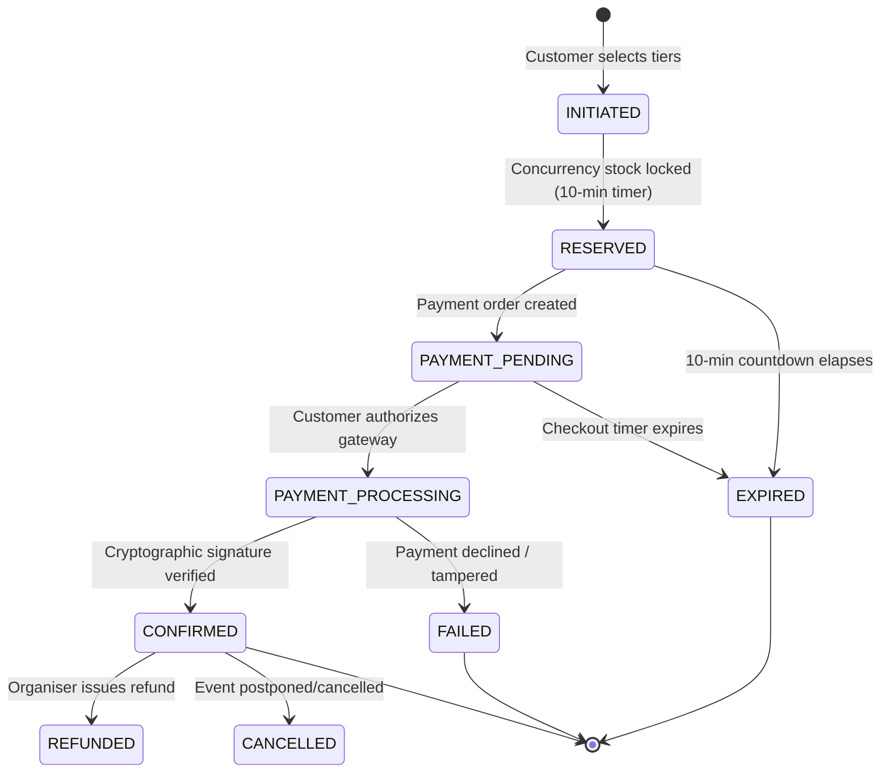

# FIREFLY V1 — System Architecture Document

## 1. Executive Summary

FIREFLY V1 is a multi-tenant event ticketing platform and organiser SaaS hybrid engineered for high-demand live entertainment experiences (concerts, electronic music festivals, exhibitions, and conferences). 

The platform is designed around strict separation of concerns, concurrency-safe inventory allocation, cryptographic ticket verification, and provider-agnostic payment processing.

---

## 2. Monorepo Structural Blueprint

The codebase is organized as an enterprise modular monorepo:

```
FIREFLY/
├── apps/
│   ├── v1/                       # Next.js 15 App Router Full Production Application
│   └── p1/                       # Reserved lightweight single-event prototype
├── packages/
│   ├── shared-types/             # Canonical domain models, enums & API schemas
│   ├── core/                     # Cryptography, HMAC signatures, UUIDs & formatters
│   ├── design-system/            # Liquid Glass design tokens & Tailwind preset
│   ├── event-engine/             # Event lifecycle, status rules & search querying
│   ├── inventory-engine/         # Concurrency-safe ticket reservation & expiry
│   ├── booking-engine/           # State machine & customer checkout logic
│   ├── payment-engine/           # IPaymentProvider abstraction & Razorpay gateway
│   ├── ticket-engine/            # Cryptographic QR ticket generation & reissue
│   ├── scanner-engine/           # Venue entrance scanning & atomic check-in logic
│   └── ui/                       # Apple Liquid Glass component library
├── infrastructure/
│   ├── database/                 # PostgreSQL migrations, functions & RLS policies
│   ├── deployment/               # Vercel & Supabase deployment configurations
│   └── security/                 # Threat models & audit checklists
└── docs/                         # Full architectural & technical specifications
```

---

## 3. Core Engine Decoupling & Abstraction

To ensure modularity and facilitate the derivation of FIREFLY P1 (the offline/single-event edition), all core business logic is encapsulated within independent packages:

| Engine | Responsibility | V1 Implementation | P1 Implementation |
| :--- | :--- | :--- | :--- |
| **`@firefly/core`** | Security primitives & token hashing | HMAC-SHA256 with server secret | HMAC-SHA256 with local organiser secret |
| **`@firefly/inventory-engine`** | Concurrency control & reservation timers | PostgreSQL `SELECT ... FOR UPDATE` + hold timers | In-browser IndexedDB transaction lock |
| **`@firefly/booking-engine`** | Order calculations & guest checkout validation | Multi-item state machine | Single-event checkout state machine |
| **`@firefly/payment-engine`** | Gateway communication & signature verification | Razorpay API + Webhook signature verification | Direct UPI deep-links + manual verification |
| **`@firefly/ticket-engine`** | QR code generation & security nonce issuance | Cryptographically signed `FF1` payload tokens | Cryptographically signed `FF1` payload tokens |
| **`@firefly/scanner-engine`** | Entrance access control & duplicate entry detection | Central PostgreSQL atomic check-in | Local IndexedDB atomic check-in |

---

## 4. Booking Lifecycle State Machine



---

## 5. Security & Anti-Counterfeit Strategy

1. **Anti-Counterfeiting:** QR codes do not embed raw booking amounts or trustable status data. Instead, they embed an HMAC SHA256 signature generated with the server's private secret:
   ```
   FF1.<ticketId>.<eventId>.<nonce>.<hmacSignature>
   ```
2. **Server-Side Nonce Check:** Every check-in request verifies the nonce and compares it to the live database record. Reissuing a ticket rotates the nonce, instantly invalidating leaked screenshots or duplicates.
3. **Atomic Gate Validation:** Multi-entrance scanning runs through the database function `atomic_check_in`, which acquires an exclusive row lock (`FOR UPDATE`) on the ticket, ensuring that two guests attempting simultaneous entry with copies of the same ticket will result in exactly one admittance and one immediate `DUPLICATE` rejection.

