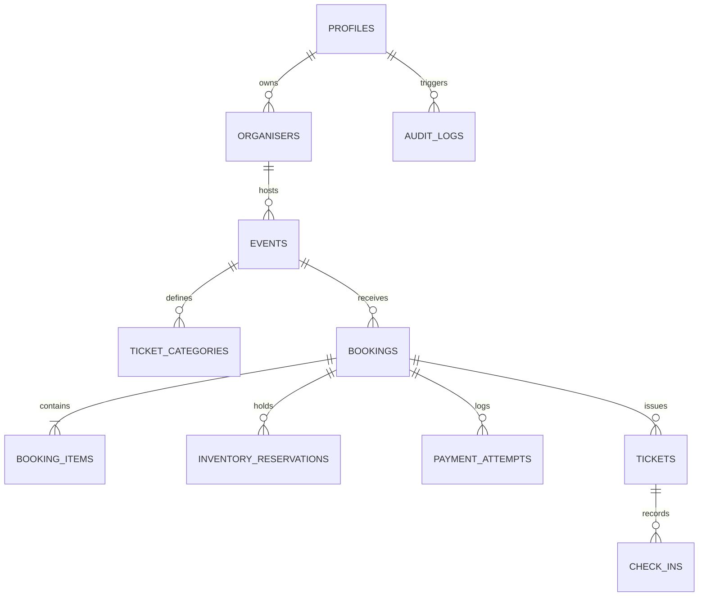

# FIREFLY V1 — Database Schema & Data Dictionary

## 1. Overview
The database engine is PostgreSQL (managed via Supabase). The schema enforces tenant boundaries, role-based access control (RBAC), ACID inventory allocations, and audit trails.

---

## 2. Entity-Relationship Diagram (ERD)

---

## 3. Core Tables

### 3.1 `profiles`
Central user registry supporting Customer, Organiser, and Super Admin roles.
- `id` (UUID, PK)
- `email` (VARCHAR(255), UNIQUE)
- `full_name` (VARCHAR(255))
- `phone` (VARCHAR(32))
- `role` ('CUSTOMER' | 'ORGANISER' | 'ADMIN')
- `created_at`, `updated_at` (TIMESTAMPTZ)

### 3.2 `organisers`
Multi-tenant organiser SaaS entity containing verified support and payout details.
- `id` (UUID, PK)
- `user_id` (UUID, FK -> `profiles.id`)
- `business_name` (VARCHAR(255))
- `support_email`, `support_phone`
- `status` ('PENDING_VERIFICATION' | 'ACTIVE' | 'SUSPENDED')
- `payout_upi_id` (VARCHAR(128))
- `payout_bank_details` (JSONB)

### 3.3 `events`
Event listings, schedules, venue metadata, and status lifecycle.
- `id` (UUID, PK)
- `organiser_id` (UUID, FK -> `organisers.id`)
- `title`, `slug` (UNIQUE)
- `category` ('CONCERT', 'MUSIC_FESTIVAL', 'NIGHTLIFE', 'EXHIBITION', 'CONFERENCE', 'THEATRE_COMEDY', 'SPORTS')
- `status` ('DRAFT', 'PUBLISHED', 'POSTPONED', 'CANCELLED', 'COMPLETED')
- `poster_url`, `gallery_urls` (TEXT[])
- `venue` (JSONB: `{ name, address, city, state, postalCode, country, googleMapsUrl }`)
- `schedule` (JSONB: `{ doorsOpenAt, startsAt, endsAt, timezone }`)
- `is_age_restricted` (BOOLEAN), `minimum_age` (INT)

### 3.4 `ticket_categories`
Ticket tiers with real-time capacity and sales thresholds.
- `id` (UUID, PK)
- `event_id` (UUID, FK -> `events.id`)
- `name` (VARCHAR(128))
- `price_in_pence` (INT, lowest currency unit, e.g. Paise for INR)
- `capacity` (INT)
- `reserved_count` (INT, active hold allocations)
- `sold_count` (INT, confirmed paid allocations)
- `min_per_booking`, `max_per_booking`
- `sales_start_at`, `sales_end_at` (TIMESTAMPTZ)
- `status` ('ACTIVE', 'SOLD_OUT', 'PAUSED', 'HIDDEN')
- Constraint: `reserved_count + sold_count <= capacity`

### 3.5 `bookings`
Master order and transaction ledger.
- `id` (UUID, PK)
- `booking_reference` (VARCHAR(32), UNIQUE, e.g. `FF-2026-X89J`)
- `event_id`, `organiser_id`
- `customer_name`, `customer_email`, `customer_phone`, `customer_whatsapp_opt_in`
- `subtotal_in_pence`, `service_fee_in_pence`, `total_amount_in_pence`
- `status` ('INITIATED', 'RESERVED', 'PAYMENT_PENDING', 'PAYMENT_PROCESSING', 'CONFIRMED', 'FAILED', 'CANCELLED', 'REFUNDED', 'EXPIRED')
- `reservation_expires_at` (TIMESTAMPTZ)
- `payment_order_id`, `payment_id`, `paid_at`

### 3.6 `tickets`
Cryptographic digital passes issued upon verified payment.
- `id` (UUID, PK)
- `ticket_number` (VARCHAR(32), UNIQUE, e.g. `VIP-8J3K-42`)
- `booking_id`, `event_id`, `ticket_tier_id`
- `attendee_name`
- `qr_payload` (TEXT, signed `FF1.<id>.<eventId>.<nonce>.<sig>`)
- `security_token` (VARCHAR(64), nonce rotated upon ticket reissue)
- `status` ('ISSUED', 'CHECKED_IN', 'REVOKED', 'TRANSFERRED')
- `checked_in_at` (TIMESTAMPTZ), `checked_in_by` (UUID)

